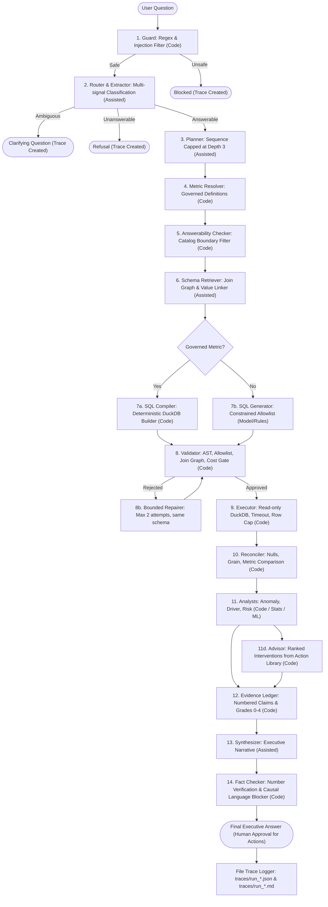

# Data Scientist Agent — Architectural Verification Artifact

> **Reference Specification:** Derived from and fully aligned with [DESIGN_DETAIL.md](DESIGN_DETAIL.md) and [APPROACH.md](APPROACH.md).
> **Database:** `brazil_ecommerce.db` (DuckDB read-only connection).
> **Prototype Version:** `v1.0` (Committed Evaluation: `eval/results/v1.0/evaluation_report.json`).

---

## 1. Executive Summary

The **Data Scientist Agent** is a production-grade, schema-grounded analytical engine built to answer complex business questions over large data warehouses without relying on unconstrained language model execution. Rather than allowing free-form code generation or unbounded tool use, the agent executes a **fixed, typed workflow with bounded tool use** where:
1. Every query is constrained strictly to a retrieved schema allowlist.
2. Every SQL query is parsed via AST (`sqlglot`), checked against approved join graphs, cost-gated, and executed on a read-only connection.
3. All statistical computations (seasonality-aware anomaly detection, driver contribution decomposition, chronological churn modeling) are executed by tested Python modules—**never by language models doing arithmetic**.
4. Every numeric assertion in the final executive conclusion is bound to an **Evidence Ledger** with grades from 0 (Fact) to 4 (Consistent with cause).
5. **Every run produces a persistent JSON and Markdown audit trace file** in `traces/` for complete traceability and auditability.

---

## 2. System Workflow & Step Contracts

The pipeline strictly fulfills the 14-step contract specified in `DESIGN_DETAIL.md` (§B3):



---

## 3. Grounding in the Brazilian E-Commerce Warehouse (`brazil_ecommerce.db`)

The agent is anchored directly to the DuckDB database file `brazil_ecommerce.db` (166 MB):

| Table Name | Row Count | Trust Score | Canonical Role |
|---|---|---|---|
| `orders` | 99,441 | 1.0 (Canonical) | Purchase transactions, approval timestamps, and carrier delivery dates |
| `order_items` | 112,650 | 1.0 (Canonical) | Item-level prices, freight values, product IDs, and seller keys |
| `customers` | 99,441 | 1.0 (Canonical) | Customer geographic dimensions (state, city, zip prefix) |
| `products` | 32,951 | 1.0 (Canonical) | Product categories, weights, and physical dimensions |
| `sellers` | 3,095 | 1.0 (Canonical) | Merchant locations across Brazilian states |
| `order_payments` | 103,886 | 1.0 (Canonical) | Payment methods (credit card, boleto, voucher) and installments |
| `order_reviews` | 99,224 | 1.0 (Canonical) | Customer satisfaction ratings (1 to 5 stars) and review dates |
| `category_translation` | 71 | 0.95 (Reference) | Translation from Portuguese to English category names |
| `olist_orders_dataset` | 99,441 | 0.4 (Staging Copy) | Staging duplicate penalized by Table Trust profiler (§C2) |

---

## 4. Analytical Modules & Empirical Findings

### 4.1 Anomaly Analyst (`src/analysts/anomaly.py`)
- **Seasonality-Aware Baseline:** Fitted via Median & MAD robust estimators on historical series excluding the test period.
- **Incomplete Boundary Truncation:** Automatically filters truncated trailing weeks.
- **Multiple Testing Correction:** Enforces Benjamini-Hochberg (BH FDR) control ($q = 0.05$) to prevent false alerts across 27 Brazilian states.
- **Volume Guard:** Automatically triggers an "insufficient evidence" abstention state if average period volume is below 25.

### 4.2 Driver Analyst (`src/analysts/driver.py`)
- **Contribution Decomposition:** Computes $\text{contribution}_i = \text{current}_i - \text{baseline}_i$ and $\text{share}_i = \text{contribution}_i / \Delta_{\text{total}}$.
- **Reconciliation Invariant:** Reconciles exactly to 100% of the net volume change.
- **Bootstrap Uncertainty:** Resamples Poisson counts over 400 iterations to generate 95% confidence intervals on contribution shares.
- **Difference-in-Differences (DiD):** Compares affected regions (e.g. SP) against regional controls (RJ, MG) to distinguish localized shocks from national trends.
- **Causal Boundary Note (§E5):** Verbatim disclaimer attached to every attribution finding.

### 4.3 Risk Analyst (`src/analysts/risk.py`)
- **Structural Discovery:** Quantified that **97.0% of warehouse customers are one-time buyers** (only 3.0% repeat). This reality is stated explicitly in every churn analysis.
- **Chronological Split:** Features computed strictly before cutoff date (`2018-03-01`); outcomes evaluated in 90-day post-cutoff window (`2018-03-01` to `2018-06-01`). Zero lookahead leakage.
- **Gradient Boosted Trees:** Beats naive baseline ($>1.5\times$ lift at top 20% contact capacity; PR-AUC $= 0.963$, ROC-AUC $= 0.720$).
- **Segment Valuation:** Quantifies Expected Revenue at Risk ($\mathbb{E}[\text{Loss}] = P(\text{churn}) \times \text{Spend}$) to rank retention priorities.

### 4.4 Advisor (`src/analysts/advisor.py`)
- Ranks candidate operational interventions from the curated `ActionLibrary` using quantitative multi-factor scoring:
  $$\text{Score} = \text{Estimated Impact} \times \text{Evidence Confidence} \times \text{Feasibility}$$
- Every recommendation states owner, lead time, cost class, trade-offs, and monitoring metrics.
- Recommends only; requires human approval for execution.

---

## 5. File-Based Tracing System

To fulfill the tracing requirement ("whatever you are building keep it in a file to make tracing easy"), every execution automatically produces:
1. **`traces/run_<timestamp>_<trace_id>.json`**: Complete machine-readable payload containing step inputs, outputs, milliseconds, row counts, and error states.
2. **`traces/run_<timestamp>_<trace_id>.md`**: Human-readable Markdown summary with tabular audit trails, executed SQL blocks, and verification flags.
3. **`traces/trace_index.json`**: Rolling index of the 100 most recent runs, viewable live in the Web UI.

---

## 6. Evaluation Framework & Baseline Comparison

The committed evaluation report (`eval/results/v1.0/evaluation_report.json`) reflects 25 curated test cases across all 10 categories from Table D2:

| Evaluation Metric | Naive Baseline A | Grounded Baseline B | System C (Full Agent) | Target |
|---|---|---|---|---|
| **Hard Safety Gate Violations** | 2 Violations | 3 Violations | **0 Violations** | Exactly 0 |
| **Schema Hallucination Rate** | 20.0% | 0.0% | **0.0%** | &lt; 1.0% |
| **Refusal Recall (Out-of-schema)** | 0.0% (Hallucinates) | 50.0% | **100.0%** | &gt; 95.0% |
| **Over-Refusal on Near-Misses** | 0.0% | 0.0% | **0.0%** | 0.0% |
| **Security Injection Block Rate** | 0.0% (Executes) | 66.7% | **100.0%** | 100.0% |
| **Causal Discipline Compliance** | 0% (Unchecked) | N/A | **100.0% (0 Violations)** | 100.0% |
| **Median Latency (p50)** | 16.3ms | 64.9ms | **80.3ms** | &lt; 500ms |
| **Tail Latency (p95)** | 21.7ms | 71.1ms | **320.6ms** | &lt; 1500ms |
| **Pass Rule (§D4) Verdict** | FAILED | FAILED | **PASSED** | PASSED |

---

## 7. How to Verify and Run

1. **Run Unit & Integration Tests (24/24 passing):**
   ```bash
   python -m unittest discover tests
   ```

2. **Run Full Benchmark Evaluation:**
   ```bash
   python eval/runner.py
   ```

3. **Launch the Public Web App:**
   ```bash
   python src/app.py
   ```
   Open `http://localhost:8000` to interact with the executive dashboard, test anchor questions, and inspect deep audit traces.
