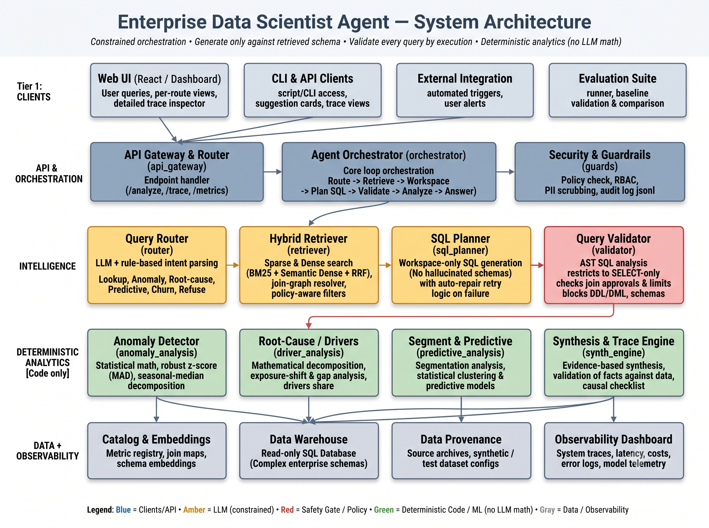
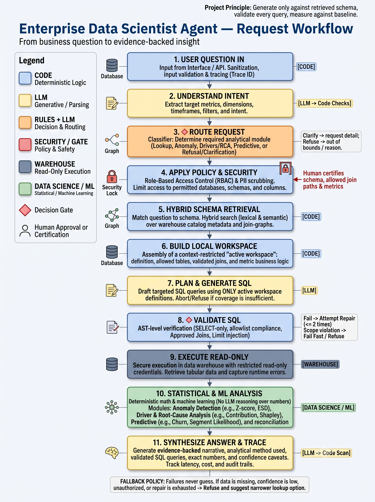

## Architecture & Workflow:

System Architecture:

Request Workflow:

## Core Pipeline Loop:
Question → React UI → FastAPI orchestrator → intent + route → policy + hybrid retrieval → authorised workspace → SQL plan → AST validate → read-only execute → deterministic analytics → evidence-bound answer + trace

## A. Problem scoping
User and decision: Sales managers and Sales Operations analysts who must act on warehouse data without waiting for a data science team. The agent supports three distinct capabilities: (1) investigating if a metric movement is unusual, (2) identifying factors driving that movement, and (3) predicting which customer segments merit retention efforts. It supports decision-making but takes no automated commercial action itself.

Input as it arrives: Free-text business questions via a web UI, structured around the two core test cases:

"Weekly orders in one region dropped sharply last month — is that unusual, and what is driving it?" (Routes to Anomaly + Drivers module).

"Which customer segments are we most likely to lose next quarter, and where should we act first?" (Routes to Predictive Churn module).
Inputs are naturally messy, often containing ambiguous metrics ("sales" instead of "gross_revenue"), relative dates, or restricted columns.

Built vs. deferred capabilities:

Built: Intent-based routing (lookup/anomaly/drivers/churn/refuse); Hybrid schema retrieval with Role-Based Access Control (RBAC); strictly read-only, AST-validated SQL generation with up to 2 repair attempts; deterministic statistical analytics; cost/latency observability tracing.

Deferred: General conversational chit-chat, warehouse write operations (DDL/DML), automated campaign triggers, and the ingestion of real personal data without explicit consent.

Measuring Success: System performance is measured against a naive single-shot LLM baseline. Core metrics include: SQL execution success rate (target ≥ 90%), zero hallucinated columns, 100% blocked unsafe queries, Anomaly Precision/Recall (target ≥ 80%), and median latency (≤ 10s).

## B. System design
Agent pattern: We selected Constrained Orchestration (State Machine) over an open-ended autonomous agent (like a ReAct loop). Unconstrained multi-agent loops cannot guarantee schema grounding, predictable latency, or safe failure modes on enterprise data. A fixed pipeline forces strict safety gates and deterministic execution.

Step-by-step pipeline:

Sanitization: Question enters via API; code scrubs PII and assigns a trace ID.

Intent Parsing: LLM extracts target metrics, dimensions, and timeframes.

Routing: A rule-first, LLM-fallback router assigns the request to Lookup, Anomaly, Drivers, Churn, Clarify, or Refuse.

Policy & Retrieval: Code limits scope based on RBAC. Hybrid RAG (BM25 + MiniLM + RRF) fetches allowed schemas and join-graphs.

Workspace Building: Code creates an isolated "active workspace" containing only the allowed tables and metrics.

SQL Planning: LLM (qwen2.5-coder:7b) drafts a query strictly limited to the active workspace.

AST Validation: Code parses the SQL Abstract Syntax Tree (AST) to enforce SELECT-only rules, block unauthorized joins, and inject limits. Fails trigger up to 2 LLM repair loops.

Execution: Code executes the query against a read-only DuckDB warehouse.

Analytics: Deterministic ML/Code calculates statistics (e.g., MAD robust z-scores, churn logistics). LLMs never perform math.

Synthesis: LLM drafts a final narrative based only on the executed rows, appending data-trace evidence and caveats.

Human approval & Failure handling: Modifying core metrics, expanding catalog access, or defining causal relationships requires human data engineer approval. If the system faces missing data, unauthorized scopes, or exhausts its SQL repair loops, it refuses the request directly and offers a narrower, supported lookup alternative instead of guessing.

## C. Data and knowledge
Data Choice: The system operates on a synthetic enterprise warehouse built around the public Spider dataset (department_store, CC0 license). To ensure a fair test matching enterprise reality, custom synthetic data (orders, inventory, promos, and a 600-user churn panel) was generated and injected with specific anomalies, seasonality, and missing values. Data generation scripts are included in scripts/.

Separation of Data: Evaluation data is strictly separated from build data. The build set uses data ≤ 2025-06-30. Validation is from July to mid-August. The held-out evaluation set uses data ≥ 2025-08-16, ensuring no time-leakage during testing.

System Knowledge: The warehouse schema, valid join-graphs, metric definitions (e.g., revenue_gross vs. revenue_net), and approved examples are stored in an artifact catalog (artifacts/catalog.json). This knowledge is retrieved dynamically per query using policy-aware hybrid search, ensuring the LLM is only prompted with relevant, accurate database context rather than the entire enterprise schema.

## D. Evaluation framework
The evaluation suite runs on every prototype commit to benchmark against the baseline and prevent regressions. It utilizes strict pass rules rather than generic accuracy averages.

Problem-specific metrics:

Retrieval: Table/column recall@k and hallucination rate (0% target).

SQL Safety: Valid execution rate and unsafe-block rate (100% target).

Analytical Correctness: Precision/Recall for Anomaly and Drivers; ROC-AUC for Churn prediction.

Faithfulness: 100% of final numbers must trace directly to executed query outputs. Zero unsupported causal claims permitted.

Operations: End-to-end latency (P50/P95) and token cost per query.

Tested Cases: The suite includes supported lookups, ambiguous queries, intentionally invalid joins, seasonal vs. true anomalies, and explicit prompt-injection/PII queries designed to trigger the refusal guardrails.

Baseline Comparison: The pipeline is continuously tested against a "Naive Baseline"—a direct text-to-SQL LLM prompted with the broad schema, with no retrieval filters, workspace constraints, or repair loops. This proves the added value (and trade-offs) of the constrained architecture.

## E. Risks and responsibility
Risks of wrong outputs: In a business context, hallucinated metrics or overstated "root causes" lead to misallocated budgets, abandoned customer segments, or ignored systemic drops.

Enforcing project principles: The principle to "validate every query by execution" is strictly enforced by the AST validation step[cite: 1]; the LLM simply cannot execute a query without code approval. Furthermore, the synthesis prompt strictly forces "association-only" language (e.g., "metric X moved alongside Y") to prevent the system from stating a root cause more strongly than observational data supports.

Deliberate trade-offs:

Latency & Cost vs. Safety: We deliberately chose a multi-stage constrained pipeline (Retrieval → Plan → Validate → Execute → Math → Synthesis). This significantly increases latency and token consumption compared to a generic LLM response, but guarantees zero math hallucinations and enforces strict data access policies.

Refusal vs. Helpfulness: The system is designed to aggressively refuse ambiguous or slightly out-of-scope queries rather than attempting a "best guess" answer, trading conversational fluidity for analytical trustworthiness.