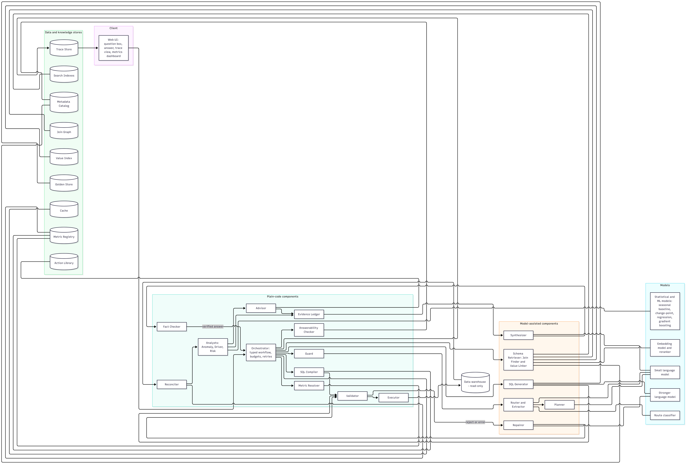

# Data Scientist Agent

Data Scientist Agent is a design for a controlled analytics assistant that turns business questions into evidence-backed answers over a data warehouse. It is intended for questions such as:

- Was the drop in weekly orders unusual, and what factors contributed to it?
- Which customer segments may be at risk of churn, and where should a person investigate first?
- What was revenue by category last year?

Rather than relying on a language model to invent schema, calculate results, or assert causes, the design grounds queries in catalogued data, validates them before execution, uses tested analytical modules, and ties claims in the final answer to recorded evidence.

> **Project status:** This repository documents the proposed system and its evaluation plan. Targets in the design are goals, not measured results. Dataset selection and licensing review are still to be finalized; consult the detailed design for current scope and prototype milestones.

## Design principles

- **Fixed, typed workflow:** application code controls the sequence, budgets, retries, and allowed analysis modules.
- **Grounded SQL:** retrieve the relevant schema and approved join paths first. Use deterministic SQL compilation for fully governed metrics; otherwise generate SQL against the retrieved schema only.
- **Validate before execution:** reject unsafe or out-of-scope SQL, enforce read-only execution, and check result quality and governed metric totals.
- **Keep analysis deterministic:** statistical and ML modules compute figures; language models may propose, draft, repair, or explain, but do not calculate results or decide whether SQL is safe.
- **Show the evidence:** link numeric and causal-sounding claims to query results or analysis outputs, and limit causal language to the evidence grade.
- **Fail closed:** clarify or refuse when the schema, data, confidence, or history is insufficient. Recommendations require human approval; the agent does not take operational action.

## Architecture and workflow

The proposed flow is:

1. A Guard checks the question for unsafe requests and injection attempts.
2. The Router and Extractor identify the question type and relevant metric, dimensions, and time window. Ambiguity leads to clarification.
3. The Planner proposes a bounded sequence of registered Analysts for compound questions; code validates the plan.
4. The Metric Resolver checks governed definitions, and the Answerability Checker determines whether the catalog can answer.
5. The Schema Retriever finds relevant tables, columns, approved join paths, and stored values. Low-confidence retrieval leads to clarification or refusal.
6. A SQL Compiler handles fully governed metrics; otherwise a SQL Generator drafts a query using only retrieved schema.
7. A Validator checks the query, allowlist, joins, fan-out risk, and cost before a read-only Executor runs it. A Repairer may try up to two fixes against the same schema.
8. A Reconciler checks results. Registered Analysts and the Advisor produce typed outputs when needed.
9. The Evidence Ledger records claims and sources. The Synthesizer drafts from that ledger, and the Fact Checker verifies claims before returning an answer.

See [DESIGN_DETAIL.md](docs/DESIGN_DETAIL.md) for the Mermaid source and full step contracts: [architecture (B1)](docs/DESIGN_DETAIL.md#b1-architecture-diagram), [workflow (B2)](docs/DESIGN_DETAIL.md#b2-workflow-diagram). [Approach.md](docs/Approach.md) provides the shorter overview and component glossary.

## Analysis modules

| Module | Intended method and safeguards |
|---|---|
| **Lookup** | Answer a grounded data question with validated SQL; use the SQL Compiler when the metric and dimensions are fully governed. |
| **Anomaly Analyst** | Compare a time series with an appropriate seasonal or robust baseline, account for multiple comparisons, and return “insufficient evidence” for sparse data. |
| **Driver Analyst** | Decompose changes into contributions, quantify uncertainty, check comparison groups and co-movement, and label the strength and limits of evidence. |
| **Risk Analyst** | Predict churn using leakage-safe chronological splits; compare against simple baselines and report calibration and segment-level risk. |
| **Advisor** | Rank a small set of evidence-linked options from a curated Action Library. A person approves any operational action. |

The proposed design defers autonomous actions, free-form model-written code execution, multi-turn dialogue management, and full causal-graph estimation.

## Data and evaluation

The evaluation plan combines public text-to-SQL benchmarks (after license review), a public transactional dataset, and synthetic enterprise-style data with planted anomalies, drivers, confounders, negative controls, and churn behavior. The synthetic generator is intended to provide scale variants of approximately 50, 200, and 500 tables.

Development and held-out snapshots and question sets are kept separate. Evaluation compares:

- A naive text-to-SQL baseline;
- A grounded SQL system with retrieval, validation, and repair;
- The full system with governed metrics, Analysts, and evidence checks.

Measures include result-match SQL accuracy, schema and safety violations, retrieval quality, anomaly and driver performance against planted truth, churn calibration, refusal and over-refusal, claim faithfulness, latency, and cost. A prototype passes only if all hard safety gates are zero and each quality and operational criterion meets its pre-set threshold. Targets must not be reported as results; measured results should include model/version, commit, data snapshot, and date.

## Security, privacy, and governance

The design calls for read-only database credentials, a retrieved-schema allowlist, approved joins, query cost and result limits, and validation before execution. Database text is treated as data, not instructions. Sensitive values are masked or excluded from profiles, prompts, traces, and logs. Access scoping is a design requirement; full row-level security is deferred. Public data sources require license and provenance review, and real personal data must not be used without consent.

## Project documentation

- [docs/Approach.md](docs/Approach.md) — concise system approach and glossary.
- [docs/DESIGN_DETAIL.md](docs/DESIGN_DETAIL.md) — detailed design, diagrams, data strategy, evaluation, risks, and delivery plan.
- [docs/Architecture.png](docs/Architecture.png) and [docs/Workflow.png](docs/Workflow.png) — rendered design diagrams.

The detailed plan proposes prototype milestones from `v0.1` (end-to-end SQL slice and baseline) through `v1.0` (held-out evaluation, scale testing, and deployment). See [Section F](docs/DESIGN_DETAIL.md#section-f--delivery-plan-prototypes-deployment-repository) for milestone details.
