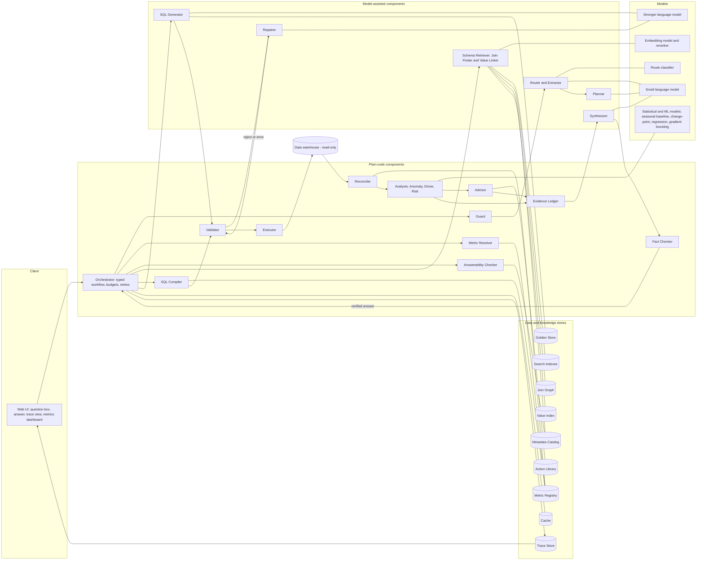
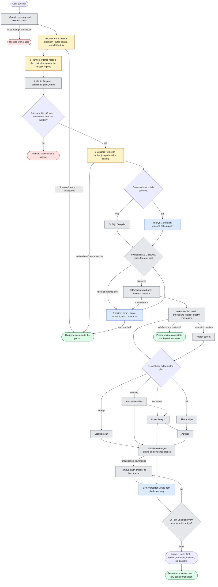

# Data Scientist Agent — Detailed Approach

> Component and store names (Guard, Router, Planner, Metric Resolver, Validator, Evidence Ledger, Golden Store, and so on) are defined once, in the [glossary in Approach.md](Approach.md#glossary).

> **Status note.** Every number marked *target* is an acceptance goal, not an achieved result. Results are reported only after the evaluation in Section D has been run on the held-out set, together with the model names and versions, commit hash and date.
>
> **Scope of this document.** This is the long-form design. A shorter, section-A-to-E entry document (max 4 pages) will be derived from it, with the detail here moved into linked files.

---

## Section A — Problem Scoping

### A1. Users, decisions and input reality

**Users:** business owners who sit on a large data warehouse but cannot write SQL or statistics: a commercial strategy lead, a supply-chain or operations head, a retention/CRM manager. They do not need a query; they need to know *whether something is unusual, what is driving it, and what to do next*, with enough evidence to defend the decision to their own management.

**How the input really arrives.** Questions are ambiguous, high-context and use business words rather than table names:

- "Weekly orders in one region dropped sharply last month — is that unusual, and what is driving it?"
- "Which customer segments are we most likely to lose next quarter, and where should we act first?"
- "What was revenue by category last year?" (a plain lookup)
- "What is the average customer age by region?" (may not exist in the warehouse)
- "Did the new carrier cause the delays?" (a causal claim the data may not support)

Real inputs also contain synonyms, abbreviations, typos, relative dates ("last month", "next quarter"), undefined business terms ("active customer", "margin") and sometimes instructions embedded in text.

**Why plain text-to-SQL is not enough.** A single prompt over a flattened schema fails on four counts: (1) it hallucinates tables and columns, so the numbers underneath are untrustworthy; (2) it cannot find the right tables among hundreds; (3) it returns rows, not an answer to "is this unusual?" or "why?"; (4) it lets a language model do arithmetic and causal reasoning it is not reliable at.

The agent is therefore a **controlled analytical workflow**: *route → ground in the real schema → generate or compile SQL → validate by execution → run a tested statistical/ML module → write the answer only from recorded evidence*.

### A2. Question classes the agent handles

| Class | Example | Handled by |
|---|---|---|
| Grounded lookup | "Revenue by category last year" | Retrieval + SQL + validation, no Analyst |
| Anomaly | "Is this drop unusual?" | Seasonality-aware anomaly module |
| Root cause (diagnostic) | "What is driving it?" | Driver-attribution module with graded evidence |
| Risk prediction | "Which segments are we most likely to lose?" | Time-split churn model + segment aggregation |
| Recommendation | "Where should we act first?" | Action-ranking module built on module outputs |
| Ambiguous | "How are sales doing?" | Clarifying question (what was understood vs. what is needed) |
| Unanswerable | Attribute that is not in the warehouse | Refusal that states exactly what is missing |
| Out of scope / unsafe | Write, delete, schema change, prompt injection | Blocked by the Guard |

### A3. Built vs. deliberately deferred

| Area | Built | Deferred |
|---|---|---|
| Routing | Hybrid router: trained lightweight classifier + rules + model proposal, validated against an allowlist | Learned multi-turn dialogue management |
| Schema grounding | Metadata catalog, column profiles, join graph, hybrid retrieval, value linking, retrieval-confidence refusal | Automatic schema migration, any write or DDL |
| SQL | SQL Compiler for governed metrics; model generation for the rest; AST validation; execution validation; bounded repair | Sandboxed model-written Python |
| Anomaly detection | Seasonal baseline with prediction intervals, robust scoring, multiple-testing control, volume guard | Bayesian structural time-series, multi-year seasonal models |
| Root cause | Contribution decomposition, price/volume/mix, bootstrap intervals, comparison-group check, graded evidence labels | Full causal-graph estimation |
| Risk prediction | Explicit churn definition, time-split features, baseline vs. gradient-boosted model, calibration | Survival models, uplift modelling |
| Recommendations | Ranked options with assumptions, trade-offs and sensitivity | Autonomous execution of actions |
| Evidence | Evidence Ledger, Fact Checker, step-by-step trace | Multi-user access control and row-level security |
| Deployment | Public web app with trace view and metrics dashboard | Multi-tenant scaling, voice interface |

### A4. Success criteria (targets to be measured)

Grouped so that no single average can hide a failure.

**Hard safety gates — must be exactly zero**
1. Executed queries that reference a table or column not in the retrieved allowlist.
2. Executed write, DDL or file-access statements.
3. Numeric claims in a final answer with no link to a query result or module output.

**SQL quality (relative to the naive baseline, same questions, same model budget)**
4. Result-match execution accuracy against gold answers or invariants, clearly higher than the naive baseline; schema-hallucination rate far lower.
5. Required-table recall@k (retrieval) high enough that retrieval is not the bottleneck; measured separately from generation.

**Analysis quality (measured against planted ground truth)**
6. Anomaly module: recall on planted anomalies and false-alert rate on negative controls both reported; target high recall at a false-alert rate near the configured level.
7. Root-cause module: top-1 and top-3 hit rate on planted drivers; contribution reconciliation error near zero.
8. Risk model: PR-AUC and lift at the team's contact capacity beating the simple baseline on a time-split hold-out; calibration reported.

**Behaviour**
9. Refusal and clarification: precision and recall both reported; near-miss answerable questions must not be over-refused.
10. Causal discipline: on "did X cause Y" cases, the answer never claims more than the evidence tier allows.

**Operations**
11. Latency p50/p95 and cost per query measured on the running system, per route, and compared with the baseline.

---

## Section B — System Design

### B0. Agent pattern: chosen and rejected

**Chosen — a fixed, typed workflow with bounded tool use.** The order of steps is defined in code. Models are called at specific steps (proposing a route, generating SQL, writing the narrative) and their outputs are validated by deterministic code before anything runs. Each Analyst is a tested function with a typed input and output.

**Rejected — an open-ended tool-using agent** that decides its own sequence and writes arbitrary SQL or Python. It is more flexible, but: cost and latency are unbounded and hard to predict; behaviour is hard to audit step by step; it can route around an allowlist; and the numbers would come from model-written code that is itself unverified.

**Rejected — a single-prompt text-to-SQL system** as the product. It is retained only as the *naive baseline* the agent is measured against.

**Revisit condition:** if the evaluation shows frequent questions that need a module the registry does not contain, add a new module through the registry (B10), not free-form code execution.

### B1. Architecture diagram

Rendered diagram: [Architecture.png](Architecture.png). The Mermaid source follows.

### B2. Workflow diagram (where a model decides, where code decides, where a person approves)

Legend: **blue = model writes**, **amber = model assists, code decides**, **grey = plain code**, **green = person**, **red = refusal / stop**. Component names are defined in the [glossary](Approach.md#glossary).

Rendered diagram: [Workflow.png](Workflow.png). The Mermaid source follows.

### B3. Step contracts

| # | Component | Receives | Returns | Model or code | On failure |
|---|---|---|---|---|---|
| 1 | Guard | Raw text | Pass / block + reason | Code (rules, pattern checks) | Block with reason |
| 2 | Router and Extractor | Question | Route, confidence, extracted slots (metric, dimension, time window) | Classifier + rules decide; model only proposes | Low confidence → clarifying question |
| 3 | Planner | Route + slots | Ordered list of Analysts to run (depth capped), validated against the Analyst registry | Model drafts; code validates | Invalid plan → single-module fallback or clarification |
| 4 | Metric Resolver | Slots | Governed metric definitions, grain, date column, required filters, or "none" | Code | Unknown term → treated as ungoverned, labelled in caveats |
| 5 | Answerability Checker | Requested entities | Answerable / not answerable + missing items | Code with retrieval confidence | Refusal naming the missing attribute |
| 6 | Schema Retriever | Question + definitions | Pruned tables and columns, join path, linked literal values, column warnings | Embedding/reranker models + code | Low confidence → clarify or refuse |
| 7 | SQL Compiler or SQL Generator | Retrieved schema, definitions, exemplars | One SQL statement | SQL SQL Compiler (code) for governed metrics; SQL Generator (model) otherwise | Goes to Validator |
| 8 | Validator | SQL + allowlist + Join Graph | Approve / reject with reasons + estimated cost | Code | Repairer |
| 8b | Repairer | Error + failed SQL + same schema | Patched SQL (max 2 attempts) | Model, capped by code | Clarification |
| 9 | Executor | Approved SQL | Rows, timing, rows scanned | Code | Repairer |
| 10 | Reconciler | Rows + definitions | Pass / flags (grain, nulls, duplicates, reconciliation) | Code | One retry, then caveat |
| 11 | Analysts (Anomaly, Driver, Risk) | Typed result tables + parameters | Typed output: numbers, intervals, flags, assumptions | Statistical/ML code | Insufficient-evidence result (not a forced answer) |
| 11b | Advisor | Analyst outputs + Action Library | 2–3 ranked options with assumptions and sensitivity | Code | "Gather more information" option |
| 12 | Evidence Ledger | Analyst and Advisor outputs | Numbered claims, each linked to a query or artifact, with evidence grade | Code | Unsupported claim dropped or labelled hypothesis |
| 13 | Synthesizer | Ledger only | Plain-language answer and next steps | Model | Fact Checker, then regenerate or fall back to a template |
| 14 | Fact Checker | Narrative + ledger | Pass / fail | Code | Remove offending sentence |

### B4. Model vs. plain code

| Model (probabilistic) | Plain code (deterministic) |
|---|---|
| Router and Extractor propose a route and slots (validated against allowlists); Planner drafts the module order | Final routing decision, thresholds, allowlists, plan validation |
| SQL Generator writes SQL for questions without a governed metric | SQL Compiler builds SQL for governed metrics; Validator checks every query |
| Repairer drafts fixes from an error message | Retry caps, schema allowlist, cost gate, read-only Executor |
| Synthesizer writes the narrative from the Evidence Ledger | All statistics, forecasts, model training and scoring, Reconciler, Advisor ranking, Fact Checker |

**Rule:** *a model may choose, draft and explain; it never computes a number, and it never decides whether a query is safe.*

### B5. Router, Extractor, Planner and question taxonomy

- **Three signals combined:** (1) a small trained classifier over question text (route label), (2) deterministic rules (verbs such as "why", "unusual", "likely to lose"; presence of a time comparison), (3) a model proposal that fills slots. Code takes the final decision; disagreement between signals lowers confidence.
- **Confidence below threshold** produces a clarifying question that states *what was understood* and *what is needed*.
- **The route and the reason are shown in every answer** ("Treated as: anomaly + root cause, because the question asks whether a change is unusual and what is driving it").
- **Planner:** compound questions ("is it unusual and why") become an ordered plan of Analysts, capped in depth. The model drafts the plan; code validates it against the Analyst registry, so the Planner cannot invent a step or call anything outside the registry.
- **Trained on:** curated questions per route plus synthetic paraphrases; evaluated as routing accuracy with a confusion matrix, including the ambiguous and out-of-scope classes.

### B6. Metric Registry, Metric Resolver and the two SQL paths

The **Metric Resolver** consults the **Metric Registry** on **every** question, before SQL is produced.

Each metric records: name and synonyms, formula, required filters (for example, exclude cancelled orders from revenue), time grain, date column, allowed dimensions, base table and join path with cardinalities, and known caveats.

- **Fully governed (metric + allowed dimensions):** a SQL Compiler produces the SQL. No model call for SQL, same SQL every time, lowest latency and cost.
- **Partly governed or analytical:** the model generates SQL with the governed definitions injected as hard constraints (formula, filters, join path, grain).
- **No governed metric:** the model generates SQL, and the answer is labelled "ungoverned metric".
- **Reconciliation:** for any governed metric in a result, the total is compared with the registry's own value for the same metric, period and filters, within a stated tolerance. A mismatch triggers one retry, then a visible caveat.

### B7. Schema Retriever: knowledge, retrieval and value linking (for hundreds of tables)

**Offline build (re-run on a schedule):**
- **Metadata catalog:** DDL, constraints, descriptions, and a profile per column (type, null rate, distinct count, min/max, formats, sample values with sensitive columns masked).
- **Join graph:** nodes are tables, edges are joins with cardinality. Declared foreign keys are used where they exist. Where they do not (the usual enterprise case), a small classifier proposes joins from name similarity, value overlap and type match; proposed edges are verified empirically (key uniqueness, containment) and carry an approval status.
- **Table trust features:** freshness, row count, duplicate rate, usage in historical queries, and a "likely stale copy" flag, so the system prefers the maintained table over an old duplicate.
- **Indexes:** keyword index (exact identifiers matter) and dense index (business synonyms) over tables, columns, descriptions and golden queries.
- **Value index:** built over categorical and low/medium-cardinality text columns; trigram or n-gram lookup at query time for high-cardinality fields such as names.

**Online retrieval:**
1. **Hybrid retrieval:** keyword + dense results fused with reciprocal rank fusion, then a cross-encoder reranker.
2. **Recall first:** a missing table cannot be recovered downstream, so retrieval is tuned for recall (score threshold, not a fixed top-k), then pruned.
3. **Join expansion:** expand along the join graph to bring in bridge tables; find join paths with shortest-path or Steiner-tree approximation, using approved edges only.
4. **Column pruning:** keep only relevant columns per table, plus keys.
5. **Value linking:** map phrases such as "North America" to stored literals (for example a region code) before generation, with a confidence score. Low confidence triggers a clarifying question.
6. **Column warnings:** profile facts are passed to the generator ("40% null", "mixed date formats", "soft-deleted rows flagged by a status column").
7. **Refusal rule:** if the needed table or attribute cannot be retrieved with adequate confidence, the system clarifies or refuses; it never asks the model to fill the gap.

### B8. Validator (before any execution)

1. Parse with an SQL parser in the target dialect; reject parse errors.
2. Exactly one statement; root must be a read-only `SELECT` (read-only CTEs allowed).
3. Reject DML, DDL, stacked statements, file-reading and extension functions, system catalog access.
4. Check every table and column against the **retrieved allowlist**. Unknown identifiers are rejected before execution.
5. Check every join against **approved join-graph edges**; flag fan-out risk (an aggregate over a table that is also joined across a one-to-many edge).
6. Require row limits and date bounds; reject unrestricted `SELECT *`.
7. **Cost gate:** dry-run or `EXPLAIN` to estimate scanned data; reject or rewrite above a budget; prefer pre-aggregated tables where the catalog marks one.
8. Execute on a **read-only connection** with timeout and result-size caps.
9. Post-execution checks: expected columns, grain, duplicates, NULL behaviour, sane ranges.
10. Reconcile with the Metric Registry where a governed metric is present.

A statement that parses is not proof that it answers the question, hence steps 5, 9 and 10.

### B9. Repairer, candidate selection and graceful degradation

- Maximum **2** repair attempts. The repair prompt contains the error, the failed SQL and the **same** approved schema; the schema is never auto-widened.
- Order: parse error → regenerate with the AST error; still failing → rule-based dialect fixes → stop.
- Runtime binder/catalog errors → targeted hints, then full revalidation.
- Reconciliation mismatch → one retry that counts toward the cap, then a caveat.
- **Empty results are not automatically wrong.** The checker distinguishes "empty because a filter is wrong" (value mismatch, impossible date range) from "empty because that is the truth", and does not push the generator toward non-empty output.
- **Optional candidate voting (evaluated as an ablation):** generate several candidates for hard questions, execute them under the cost gate, and choose by result agreement. Disagreement lowers confidence and triggers a clarification.
- After the cap, a policy violation or repeated logical failure → structured clarification (`what_understood` / `what_needs_clarification`).

### B10. Analysts and Advisor

All modules share one contract: **typed input tables + parameters → typed output** containing numbers, intervals, flags, assumptions and an "insufficient evidence" state. Every module has unit tests (sparse data, zero baseline, empty segments, short history) and is scored against planted ground truth (Section D).

**Analyst registry.** A new analysis (for example forecasting or cohort comparison) is added by registering a module with its contract, tests and evaluation cases. Free-form code execution is not permitted.

#### B10.1 Anomaly Analyst

- **Data prep:** aggregate to a regular series at the question's grain; drop incomplete boundary periods; flag sparse or truncated history; calendar features (holidays, promotion periods) from a calendar table when available.
- **Baseline:** seasonality-aware expectation, for example a seasonal-trend decomposition or seasonal naive/ETS forecast with a prediction interval, fitted on history that **excludes** the tested period. Fall back to a trailing-window robust baseline (median and MAD) when history is too short, and say so.
- **Scoring:** actual vs. expected, percentage deviation, robust score, interval position, and persistence (one odd week vs. a sustained shift).
- **Change-point check:** a change-point method (for example PELT) distinguishes a sudden level shift from drift or a one-off spike.
- **Many series:** when scanning many regions or segments, control false discoveries (Benjamini–Hochberg or a stricter threshold) and report the correction used.
- **Volume guard:** below a minimum count, return "insufficient evidence" rather than a label.
- **Output:** verdict (unusual / within normal range / insufficient evidence), expected range, deviation, window, threshold, correction used, and the calendar effects considered.

#### B10.2 Driver Analyst (root-cause exploration)

- **Define first:** metric, current period, comparison period, and a metric tree (for example orders = customers × orders per customer; revenue = volume × price × mix).
- **Contribution decomposition:** over mutually exclusive dimensions (category, channel, carrier, region, customer group): `contribution_i = current_i − baseline_i`, `share_i = contribution_i / total_change`. Contributions must **reconcile** to the total within tolerance.
- **Price / volume / mix:** for value metrics, split change into price, volume and mix effects.
- **Uncertainty:** bootstrap intervals on contributions; show sample sizes; flag unstable shares from small cells.
- **Co-movement evidence:** test whether candidate operational indicators (for example delivery delay, stock-outs, discount depth) moved in the same window and, where data allows, at a lag; report the association strength and its limits.
- **Comparison group:** where a comparable unchanged group exists (other regions, unaffected segments), run a difference-in-differences style comparison to test whether the shift is specific to the affected unit.
- **Search control:** cap the number of dimensions and drill-down depth, and correct for the number of candidate drivers examined, to avoid finding a "driver" by chance.
- **Output:** ranked drivers with share, interval, sample size, evidence grade (B11) and the data that would be needed to strengthen the claim.

#### B10.3 Risk Analyst (churn-risk prediction)

- **Explicit definition:** a customer is "lost" if there is no purchase in the N days after a cut-off date; N and the active-customer definition come from the Metric Registry. If most customers are one-time buyers, that is stated in every answer.
- **Leakage-safe design:** features are computed only from data before the cut-off; train/validation/test splits are **chronological**; no information from the outcome window enters any feature.
- **Features:** recency, frequency, monetary value, tenure, inter-purchase gaps, recent trend in spend, service-quality signals (delays, complaints, review scores), category and region.
- **Models:** a simple heuristic segmentation and a regularised logistic regression as baselines, versus a gradient-boosted model. The more complex model ships only if it beats the baseline on the hold-out.
- **Evaluation:** PR-AUC reported with prevalence, ROC-AUC, Brier score and calibration curve, and precision/lift at the team's contact capacity (top-k).
- **Segment view:** predicted risk is aggregated to business segments with expected revenue at risk = probability × customer value, and confidence intervals from resampling.
- **Output:** ranked segments, risk drivers (feature importance as association, not cause), calibration note, and limits (short history, class imbalance).

#### B10.4 Advisor (recommendations)

- **Inputs:** module outputs (confirmed anomaly, ranked drivers, at-risk segments) plus an **Action Library**: curated actions linked to driver types, with preconditions, owner, typical lead time and cost class.
- **Ranking:** score = estimated impact × evidence confidence × feasibility, where impact comes from the quantified data (revenue at risk, share of decline), not from the model's opinion.
- **Output:** two to three options with assumptions, trade-offs, sensitivity to the key assumption, what to monitor, and what additional data would change the ranking. **The agent recommends; a person approves.** It never executes actions.
- **When the evidence is weak:** recommend the cheapest *information-gathering* step (for example "check the carrier's delay log for this region") instead of a costly intervention.

### B11. Evidence grading (how strongly a cause may be stated)

| Grade | Meaning | Allowed wording |
|---|---|---|
| 0 | Fact from a query | "Orders fell 18% versus the expected range." |
| 1 | Concentration | "The decline is concentrated in category X (62% of the change)." |
| 2 | Co-movement | "Delivery delays rose in the same weeks." |
| 3 | Specific to the affected unit vs. a comparison group | "The shift did not appear in comparable regions." |
| 4 | Consistent with a cause, not proven | "This is consistent with a carrier problem; it would need X to confirm." |

Language such as "caused", "because of" or "due to" is **blocked** by the Fact Checker unless a grade 4 label is attached and the limits are stated. Every driver analysis ends with the causal-boundary note (E5).

### B12. Evidence contract and Evidence Ledger

Every answer contains: **route and reason** · **conclusion** (only what the evidence supports) · **scope** (metric, window, filters, grain, data range) · **evidence** (actual vs. expected, contributions, counts, intervals) · **method and parameters** · **executed SQL with status and timing** · **trace** (retrieved schema, join path, validations, repairs) · **caveats** · **next action** (human approval for any operational step) · **run metrics** (latency, tokens, queries, rows, retries).

**Evidence Ledger:** every numeric or causal-sounding sentence is linked to a query ID or module artifact and an evidence grade. The narrative model may paraphrase but may not introduce a figure; the Fact Checker compares every number in the final text with the ledger and removes or relabels anything unsupported.

### B13. Human-in-the-loop points

| Point | What the person does |
|---|---|
| Clarification | Answers the question the agent asks when intent, a term or a value is ambiguous |
| Recommendation | Approves or rejects any operational action; the agent never acts |
| Golden Store | Reviews a validated query before it becomes a reusable example |
| Metric Registry changes | Approves new or changed metric definitions |
| Low-confidence answer | Sees an explicit confidence note and can request an analyst review |

### B14. What happens when something fails

| Failure | System behaviour |
|---|---|
| Question not answerable from the catalog | Refusal naming the missing attribute; suggests the closest answerable question |
| Retrieval confidence low | Clarifying question; no generation |
| SQL rejected or errors | Up to 2 repairs against the same schema, then clarification |
| Query too expensive | Cost gate rewrite or refusal with an explanation |
| Reconciliation mismatch | One retry, then answer with a visible caveat |
| History too short or volume too low | "Insufficient evidence", with what would be needed |
| Model unavailable or times out | Fall back to the SQL Compiler path where possible; otherwise a clear error, never a guess |
| Fact Checker fails | Remove or relabel the claim; if the narrative cannot be repaired, return a template-based answer from the ledger |
| Prompt injection in data or question | Treated as data, not instructions; blocked or ignored; logged |

### B15. Accuracy, latency and cost design

- **Deterministic fast path** for governed metrics: no SQL model call.
- **Model tiering:** small model for routing assistance, slot filling and narration; stronger model only for complex multi-table SQL and repair, chosen by a predicted-difficulty signal.
- **Small prompts by design:** retrieval and pruning keep the prompt to a handful of tables instead of the whole schema.
- **Caching:** exact-match cache for repeated questions; a **slot-based plan cache** keyed on normalised metric, dimension, filters and time range (not raw embedding similarity, because "Texas" and "California" questions embed almost identically but need different SQL); invalidated on schema or definition change and scoped by user permission.
- **Cost gate** before execution; pre-aggregated tables preferred where available.
- **Parallel execution** of independent module queries.
- **Per-query budgets** for tokens, queries and wall time, enforced by the orchestrator and visible in the trace.

### B16. Security and governance

- Read-only credentials; no write path exists in the application.
- Sensitive columns masked or excluded from profiles, prompts, traces and logs.
- Text read from the database (including values pulled in by value linking) is **data, never instructions**.
- Access scoping per user for tables, columns and cached results (design hook now; full row-level security deferred).

---

## Section C — Data and Knowledge

### C1. Data strategy: three layers, each testing something different

| Layer | Purpose | What it proves |
|---|---|---|
| **Public text-to-SQL benchmark databases** (selected after a licence check) | Many databases with real schemas, dirty values and executable gold answers; a subset with very wide, enterprise-style schemas | SQL grounding, retrieval recall, value linking, refusal and repair at scale |
| **A public transactional dataset with orders, customers, products and delivery history** | A realistic business time series and customer purchase history | A believable setting for the two mandatory situations |
| **A synthetic enterprise layer generated by a documented script** | Enterprise-style mess, scale, **and planted ground truth** | Whether the anomaly, root-cause and risk modules are actually *right* |

The public sources test the SQL half. Only the synthetic layer can test the analysis half, because public benchmarks contain no known anomalies, drivers or churn labels. Each layer's role is stated explicitly so that no layer is asked to prove something it cannot.

*(Specific datasets are finalised after the licence and access review; the provenance table in C5 is filled in then.)*

### C2. What makes it look like an enterprise warehouse

The synthetic layer is generated to reproduce what business users actually face:

- **Scale ladder:** variants with roughly 50, 200 and 500 tables, so accuracy and latency can be plotted against schema size.
- **Cryptic and inconsistent naming:** abbreviations and legacy prefixes (for example `ord_hdr`, `cust_dim_v2`), mixed naming conventions across subject areas.
- **Duplicated and stale entities:** old copies, staging tables, near-duplicate dimension tables with different freshness.
- **Messy values:** casing variants, trailing spaces, region names vs. codes, mixed date formats and time zones, numbers stored as text, placeholder values ("N/A", "-1"), nulls concentrated in particular columns.
- **Duplicate and merged customers:** the same person under several identifiers.
- **Missing declared keys:** foreign keys absent so the join classifier is genuinely needed.
- **Soft deletes, cancelled and test records** that must be excluded for correct metrics.
- **Late-arriving and truncated data** at the tail of the history.
- **Distractor tables:** plausible but irrelevant tables that look like the right answer.
- **Unanswerable asks:** attributes that appear in business language but exist nowhere in the schema (used for refusal tests).

### C3. Planted ground truth

The generator writes a **ground-truth manifest** that the agent cannot read:

- **Planted anomalies** of several kinds: sustained level shift, one-week spike, short dip, gradual decay, with known start, size and affected unit.
- **Planted drivers:** the cause of each anomaly is known (a segment, a category, a carrier, a price change) with its true share of the change.
- **Confounders:** a second factor that moves with the driver but is not the cause, to test causal discipline.
- **Negative controls:** ordinary weeks, holiday and promotion peaks, small-volume units, and random fluctuation, so false alerts are measured.
- **Customer behaviour process:** a documented stochastic process that generates repeat purchases and lapses, so churn labels and the true risk structure are known.
- **Seeded SQL traps:** fan-out joins, cancelled-order inclusion, and duplicate rows, each with a known correct answer.

### C4. Keeping build data and evaluation data separate

- **Two snapshots** generated with different random seeds and different injection configurations: a **build snapshot** used for development and tuning, and a **held-out snapshot** used only for final evaluation.
- **Question sets:** a development set and a locked held-out set; prompts, thresholds and models are tuned only on the development set.
- **Public benchmark splits:** use the training split for building (examples, retrieval tuning) and the development/test split for evaluation; never tune on the evaluation split.
- **Golden Store** contains only development-set material; held-out questions are checked against it for leakage before every final run.
- The held-out manifest is stored separately and is read only by the scoring code.

### C5. Provenance, licence and privacy

| Item | Record kept |
|---|---|
| Each public source | Name, URL, version/date retrieved, licence, permitted use, which layer and split it feeds |
| Synthetic data | Generator code, seed, configuration, and the prompts (if a model helped write generator code or business text) versioned in the repository |
| Derived artefacts | Scripts that build catalog, profiles, join graph and indexes, so the stores can be rebuilt from scratch |

No real person's personal data is used without consent; public sources must be anonymised, and sensitive columns are masked in profiles, prompts and logs. If a licence is non-commercial or share-alike, that restriction is recorded and respected in how the repository and deployment are described.

### C6. Knowledge stores and how they are retrieved

| Store | Contents | Retrieved by |
|---|---|---|
| Metadata Catalog | DDL, descriptions, types, null/distinct/range statistics, formats, masked samples, table trust features | Direct lookup after retrieval |
| Join Graph | Tables, edges, cardinalities, approval status | Path finding over approved edges |
| Metric Registry | Metric definitions, synonyms, grain, filters, allowed dimensions, reconciliation values | Synonym match + exact lookup |
| Search Indexes | Tables, columns, descriptions, golden queries | Hybrid retrieval + reranking |
| Value Index | Categorical values and name n-grams | Fuzzy and trigram lookup with confidence |
| Golden Store | Verified question–SQL pairs | Similarity retrieval of top few exemplars |
| Action Library | Actions linked to driver and segment types | Rule-based match from module outputs |
| Cache | Normalised plans and results | Exact key on slots |
| Trace Store | Every step, timing, token count, retry | Dashboard and trace view |

**Controlled learning loop.** Queries are *not* automatically added to the Golden Store. A query is promoted only after it passes result checks (reconciliation or a known-answer test) **and** a person approves it, because "ran without error" does not mean "correct", and indexing wrong-but-running SQL would poison later retrieval. Logged user corrections feed retraining of the router and retriever on a schedule, evaluated on the development set first.

---

## Section D — Evaluation Framework

### D1. Metrics, and why each one

| Layer | Metric | Why |
|---|---|---|
| Routing | Accuracy, confusion matrix, clarify/refuse precision and recall | A wrong route wastes the whole run; refusal needs both precision and recall |
| Retrieval | Required-table recall@k, required-column recall@k, MRR, join-path correctness | A missing table cannot be recovered later; measured separately from generation |
| Value linking | Value-grounding accuracy, confidence calibration | Wrong literals return plausible but wrong numbers |
| SQL safety | Schema-hallucination rate, unauthorised-reference rate, blocked-write rate | Direct measure of the project principle |
| SQL correctness | Execution success, **result match against gold** (not just "ran"), fan-out and status-filter test pass rate | Success of execution is not correctness |
| Anomaly module | Recall on planted anomalies, false-alert rate on negative controls, detection delay, interval coverage | Both missing real problems and crying wolf cost the user |
| Root-cause module | Top-1/top-3 driver hit rate, contribution reconciliation error, false-driver rate, confounder-confusion rate | Tests attribution and causal discipline |
| Risk module | PR-AUC with prevalence, ROC-AUC, Brier, calibration error, lift/precision at top-k, segment-level ranking agreement with planted truth | Accuracy alone is misleading for imbalanced outcomes |
| Recommendation | Rubric score (specific, evidence-linked, assumption-stated, trade-offs shown) by reviewers; agreement on ranking with planted best action | Usefulness cannot be measured by a number alone |
| Faithfulness | Share of numeric claims linked to the ledger, unsupported-claim rate, blocked-causal-language violations | Enforces "no LLM math" and honest causal wording |
| Abstention | Refusal precision/recall, over-refusal rate on near-miss questions, clarification usefulness | Saying "cannot answer" must be right, and not overused |
| Operations | p50/p95 latency per route and per stage, tokens and cost per query, retries, failure rate | Accuracy, latency and cost are traded off deliberately |

### D2. Test suite (target sizes; grows with each prototype)

| Category | Target cases | Purpose |
|---|---|---|
| Governed metric lookups | ~30 | Fast path correctness and consistency |
| Multi-table joins, messy values | ~30 | Retrieval, join path, value linking, fan-out traps |
| Anomaly | ~20, of which ~8 negative controls | Detection and false-alert rate |
| Root cause | ~15, including confounder cases | Attribution and causal discipline |
| Risk prediction | ~10 segment-level tasks | Model quality and calibration |
| Recommendation | ~10 | Usefulness rubric |
| Out-of-schema refusals | ~25, including paraphrases | Refusal precision and recall |
| Near-miss (answerable but looks unanswerable) | ~10 | Over-refusal |
| Ambiguous / handoff | ~10 | Clarification quality |
| Causal-overclaim ("did X cause Y?") | ~10 | Wording limited to evidence grade |
| Injection and unsafe requests | ~10 | Safety gates |
| Scale ladder | Same subset at 50 / 200 / 500 tables | Degradation curve |

Each answerable case stores a **gold result or invariant**; each analysis case stores the planted truth it should recover. A development subset is used for tuning and a locked held-out subset for final reporting.

### D3. Baselines and ablations

- **Baseline A — naive text-to-SQL:** one prompt, flattened full schema, first output taken, no retrieval, validation or repair.
- **Baseline B — grounded SQL only:** retrieval + validation + repair, no Analysts and no Metric Registry.
- **System C — full agent.**
- **Ablation ladder** on identical questions, snapshot, model and budget: A → + retrieval → + value linking → + validation → + repair → + Metric Registry and SQL Compiler → + modules → + Fact Checker. Each step's effect on accuracy, latency and cost is reported.
- **Module baselines:** anomaly vs. a fixed ±2σ trailing-window rule; driver attribution vs. a naive "largest absolute change" rule; risk model vs. the heuristic segmentation.
- **Path comparison:** governed questions run through both the SQL Compiler and the SQL Generator, to report latency, cost and result consistency.
- **Scale test:** accuracy and latency of A, B and C across the 50 / 200 / 500-table ladder.

Report **paired per-question results**, include refusals and failures in the denominator, count a correct refusal as correct, and plot accuracy against latency and cost.

### D4. Pass rule

The system passes a prototype only if **all** of the following hold on the evaluation run:

1. **All hard gates are zero:** no executed unknown identifier, no executed write, no unsupported numeric claim.
2. **SQL correctness** clearly exceeds Baseline A, with a lower schema-hallucination rate (thresholds calibrated on the development set and fixed before the held-out run).
3. **Each Analyst** meets its own threshold against planted truth (anomaly recall and false-alert rate; driver top-3 hit rate; risk model beats the baseline on the chronological hold-out).
4. **Refusal and over-refusal** are both within their thresholds.
5. **Causal-overclaim cases:** zero answers that exceed their evidence grade.
6. **Latency and cost** are within the per-route budgets, or the trade-off is documented.

A failure in any one item is reported as a failure; categories are never averaged together to hide it.

### D5. Running on every prototype

- Each prototype is a **tagged version** (Section F). The full suite runs on each tag and the results are committed (`eval/results/<tag>/`), so improvement over time is visible.
- The same runner feeds the **observability view**, showing the problem metrics (hallucination rate, result accuracy, module scores, refusal precision/recall, faithfulness) next to accuracy, p50/p95 latency and cost, per route and per stage, on the running system.

### D6. Reporting rule

Targets are goals. Report measured values with model name and version, commit hash, data snapshot id and date. Do not present a target as a result.

---

## Section E — Risks and Responsibility

### E1. What a wrong output does to the person relying on it

| Output | Consequence if wrong |
|---|---|
| Hallucinated or wrongly joined number | A decision is made on a figure that does not exist or is inflated |
| False anomaly alert | Seasonal noise becomes an escalation; trust in the tool drops |
| Missed real anomaly | A real problem goes unaddressed |
| Overstated root cause | Money and time are spent fixing the wrong thing |
| Miscalibrated risk list | Retention budget is spent on the wrong customers |
| Bad recommendation presented with confidence | Operational harm, because it looks evidence-backed |
| Query on a sensitive attribute that should not be used | Compliance exposure |

A hallucinated figure is worse than a refusal. The agent therefore **fails closed**: when an attribute, definition or enough history is missing, it says exactly what is missing instead of guessing.

### E2. How the project principle is enforced

*"Generate only against the retrieved schema; validate every query by execution; measure against a naive baseline."*

1. **Allowlist from retrieval:** the SQL Generator and SQL Compiler are given only retrieved tables and columns, and the validator rejects anything else before it can run.
2. **Join graph:** only approved joins are accepted.
3. **Execution validation:** every query runs read-only with a cost gate; errors feed a bounded repair.
4. **Result-level checks:** grain, duplicates, nulls and reconciliation, because parse success is not correctness.
5. **Retrieval-confidence refusal:** no retrieval match means refuse, never "fill the gap".
6. **Evidence Ledger and Fact Checker:** no number reaches the user without a source.
7. **Baseline comparison:** every prototype is scored against the naive baseline on the same questions.

### E3. Answerability Checker caveat

A keyword or pattern interceptor is fast but brittle (synonyms, typos, indirect phrasing, or "age" inside "average"). It is used only as a first cheap filter and is backed by retrieval confidence and a labelled refusal set with paraphrased variants; precision **and** recall are reported.

### E4. Trade-offs

| Decision | Cost | Benefit |
|---|---|---|
| Fixed workflow instead of an open-ended agent | Less flexible; new analyses must be added as modules | Predictable cost, latency and audit trail; no unvalidated code |
| AST validation + cost gate | Tens of milliseconds and some false rejections | Blocks unsafe or runaway queries before execution |
| Metric Registry + Reconciler | Upfront definition work and an extra aggregate query | Consistent metrics, silent logic errors caught |
| Join graph and join classifier | Offline build and verification effort | Valid join paths and fan-out detection |
| Seasonal baseline + multiple-testing control | Lower sensitivity (some real anomalies missed) | Fewer false alerts |
| Bootstrap intervals and comparison groups | More computation per question | More honest uncertainty on drivers |
| Trained risk model vs. simple heuristic | Training, calibration and monitoring work | A genuine probability and ranking quality, measurable against a baseline |
| Model tiering | Occasional wrong tier choice | Large cost and latency saving |
| Slot-based cache instead of similarity cache | Lower cache hit rate | Avoids returning wrong cached SQL |

**Deliberate trade-off to defend:** the agent accepts **lower recall on anomalies and fewer answered questions** (more clarifications and "insufficient evidence" responses) in exchange for **very few false alerts and no unsupported claims**. The cost is that some users get "I cannot say" where an unconstrained system would have given a confident answer. This is measured through the over-refusal and detection-delay metrics so the cost is visible rather than hidden.

### E5. Causal boundary (attached to every driver analysis)

> *"Observed covariation indicates association, not proven causation. Unmeasured factors such as local events, competitor actions or data issues may also explain the pattern. The evidence grade above shows how strongly the data supports each statement, and what additional data would be needed to go further."*

### E6. Other responsibilities and limits

- **Privacy:** no real personal data without consent; masked profiles; no raw identifiers or secrets in traces or logs.
- **Human in the loop:** the agent recommends and never executes actions.
- **Prompt-injection hygiene:** data and user-pasted text are never treated as instructions.
- **Model dependence:** answers depend on the language model used; model name and version are recorded with every result, and the deterministic path works without a model for governed questions.
- **Limits stated to the user:** a benchmark or synthetic warehouse does not prove performance on a specific real enterprise; synthetic ground truth tests the methods, not the real world; local timings do not reflect cloud-warehouse cost; association analyses cannot establish causes.

---

## Section F — Delivery Plan (prototypes, deployment, repository)

### F1. Prototype tags

| Tag | Content | What the evaluation shows |
|---|---|---|
| `v0.1` | First end-to-end slice: question → retrieval → SQL → validation → answer; naive baseline harness | Baseline A numbers; first hallucination rate |
| `v0.2` | Hybrid retrieval, join graph, value linking, bounded repair, refusal | Retrieval recall, hallucination drop, refusal precision/recall |
| `v0.3` | Metric Registry and Metric Resolver, SQL Compiler fast path, Reconciler, cost gate | Consistency, latency and cost gain |
| `v0.4` | Anomaly module and root-cause module with planted-truth scoring | Detection recall, false-alert rate, driver hit rate |
| `v0.5` | Risk Analyst, Advisor, evidence grading | PR-AUC, calibration, rubric scores |
| `v0.6` | Evidence Ledger, Fact Checker, trace UI, dashboard | Faithfulness rate, full observability |
| `v1.0` | Held-out evaluation, scale ladder, public deployment | Final results against the pass rule |

### F2. Deployment

A public web application with a question box, the answer view (route, SQL, method, numbers, caveats), a step-by-step trace view for any run, and a metrics page. The deployment decision (hosted model API vs. self-hosted model) is made early because it changes the latency and cost figures and the baseline comparison. Secrets live in environment configuration, never in the repository.

### F3. Repository contents

- `README.md` — setup and run from scratch
- `docs/Approach.md` and `docs/DESIGN_DETAIL.md`, with rendered diagrams in `docs/Architecture.png` and `docs/Workflow.png` and their Mermaid sources in Section B
- `src/` — application, Analysts, Advisor, Validator, SQL Compiler
- `data_gen/` — synthetic generator code and configuration, with seeds
- `prompts/` — every prompt the system runs on, as versioned files (prompt pack)
- `eval/` — evaluation set, runner, ground-truth manifest handling, committed results per tag
- `observability/` — dashboard or trace view configuration
- `agent_setup/` — the coding-agent setup the team built with: rules files, specification, subagents, hooks, reusable prompts

### F4. Method references (to be completed with final citations)

Hybrid retrieval and reciprocal rank fusion; cross-encoder reranking; schema-linking and multi-stage text-to-SQL pipelines; SQL parsing and AST validation (`sqlglot`); graph path finding (`networkx`); seasonal-trend decomposition and ETS forecasting (`statsmodels`); change-point detection (PELT); false-discovery-rate control (Benjamini–Hochberg); bootstrap intervals; difference-in-differences; gradient boosting and probability calibration (`scikit-learn`).
